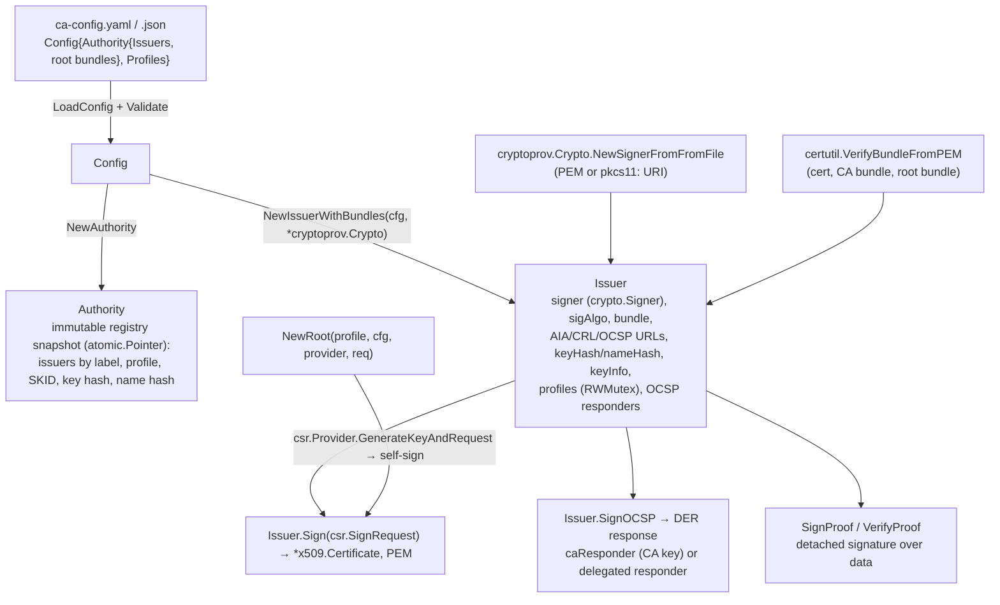

# authority: design

## Purpose and position

`authority` is an in-process Certification Authority: it loads issuers and
certificate profiles from YAML or JSON, builds `Issuer` objects whose
private keys come from `cryptoprov` (PEM or `pkcs11:` URI) and whose chains
are verified by `certutil`, issues X.509 certificates from PEM CSRs under a
named profile, signs OCSP responses directly or through a delegated
responder, and bootstraps self-signed roots. It depends on `csr`,
`certutil`, `cryptoprov` (and `inmemcrypto` for the delegated responder
key), `oid` and `metricskey`. Nothing in the library depends on it; it is
the top of the stack for a CA service built on this module.

The detailed signing rules (field ownership, extension precedence,
validity envelope, OCSP renewal) are in
[`authority/README.md`](../../authority/README.md) and the invariants in
the [code map](../codemap.md#package-authority); this document explains
the structure and the reasons.

## Core abstractions



| Abstraction             | File            | Role                                                                                                                                                      |
| ----------------------- | --------------- | --------------------------------------------------------------------------------------------------------------------------------------------------------- |
| `Config`, `IssuerConfig`, `CertProfile`, `AIAConfig` | `config.go` | Declarative CA: issuer label, type, cert/key/bundle files, AIA URL templates (`${ISSUER_ID}`/`:ISSUER_ID` → issuer SKID), expiries, `allowed_profiles`; profiles with usages, CA constraints, name regexes, `allowed_fields`, `allowed_extensions`, policies, raw extensions, expiry and backdate. `Validate` compiles regexes and rejects colliding OIDs. |
| `Authority`             | `authority.go`  | Registry of issuers and profiles with lock-free lookups; copy-on-write under a mutex for `AddIssuer`/`AddProfile`.                                        |
| `Issuer`                | `issuer.go`     | One signing key and chain. `sigAlgo` is fixed at construction by `csr.DefaultSigAlgo(signer)`; `keyInfo` (type, size, hash) by `certutil.NewKeyInfo`; `keyHash`/`nameHash` per hash for OCSP `CertID` matching. |
| `Issuer.Sign`           | `issuer.go`     | The issuance pipeline: parse and verify CSR, copy permitted fields, merge RA subject, regex checks, extension precedence (profile > RA > CSR), `fillTemplate`, `x509.CreateCertificate`. |
| OCSP responders         | `ocsp.go`       | `caResponder` (immutable) and a delegated responder (atomic snapshot, renewed under `renewLock`, in-memory P-256 key issued by `Sign` with the delegated profile). `SignOCSP` builds the response with `golang.org/x/crypto/ocsp`. |
| `NewRoot`, `Issuer.GenCert` | `root.go`, `util.go` | Bootstrap: generate a key through a `cryptoprov.Provider`, build a CSR with `csr`, self-sign (root) or sign with an issuer (GenCert), write files (`.key` 0600, existing files renamed `.bak`). |

## Main flow: issuing a certificate

```mermaid
sequenceDiagram
    participant RA as RA (trusted)
    participant I as Issuer.Sign
    participant CSR as csr.ParsePEM
    participant X as x509.CreateCertificate
    RA->>I: SignRequest{Request, Profile, Subject?, SAN?, Extensions?, NotBefore?, NotAfter?}
    I->>I: profile lookup (default), snapshot
    I->>CSR: parse + CheckSignature
    CSR-->>I: template (public key, subject, SANs, raw extensions)
    I->>I: copy fields per allowed_fields; validate SANs; merge RA subject; regexes
    I->>I: extensions: profile (dup OID fails) → RA (allow-list, empty = all) → CSR (allow-list, empty = none; profile-owned OIDs always dropped)
    I->>I: fillTemplate: validity window, KU/EKU, CA constraints, SKI, AIA/CRL/OCSP URLs, policies, OCSP no-check
    I->>X: CreateCertificate(template, issuerCert, csrPublicKey, issuerSigner)
    X-->>I: DER
    I-->>RA: *x509.Certificate, PEM
```

## Design decisions

- **Trusted RA, untrusted CSR.** The `SignRequest` may set subject, SANs
  and extensions because it comes from the service that authenticated the
  requester; the CSR only contributes what the profile's `allowed_fields`
  and `allowed_extensions` permit, and never the policy-bearing
  extensions (XPKI-049). This is the security boundary of the package.
- **Profiles own policy, issuers own identity.** A profile says what a
  certificate may contain; an issuer says who signs and where AIA points.
  Profiles attach to issuers by label or wildcard, filtered by
  `allowed_profiles` (XPKI-057), so one config can drive several CAs.
- **Immutable snapshots for hot paths.** `Authority` lookups and profile
  reads are lock-free; mutation is rare (`AddIssuer`, `AddProfile`) and
  copies. Registered profiles are shared and must not be modified
  (XPKI-055).
- **Signature algorithm fixed per issuer.** `sigAlgo` is derived once
  from the signer (`csr.DefaultSigAlgo`), so a KMS key that only signs
  SHA-256 is never asked for SHA-384 (XPKI-114), and every certificate of
  an issuer carries the same algorithm.
- **OCSP never falls back to the CA key when delegated.** A delegated
  responder that cannot be renewed yields an error, not a CA-signed
  response (XPKI-051/052/053). Renewal is single-flight and callers with
  a still-valid responder never wait.
- **Validity is rejected, not adjusted** (XPKI-054), except for clipping
  to the issuer's `NotAfter`, which is the only safe adjustment.
- **Hash choices.** `supportedKeyHash` (SHA-1, SHA-256, SHA-384, SHA-512)
  precomputes `CertID` hashes for OCSP lookups, SHA-1 included because
  RFC 6960 clients send it. `SignProof` uses `keyInfo.Hash`, the hash
  `certutil.NewKeyInfo` pairs with the key size.

## Extension points

- **Issuer types** (`IssuerConfig.Type`) are labels for the operator; the
  package applies no type-specific logic.
- **New profile fields** go in `CertProfile` with `Validate` rules and a
  row in the README extension table; new template fields are set in
  `fillTemplate`.
- **Revocation.** The package signs OCSP responses and carries CRL
  expiry/renewal settings and URLs; CRL generation itself is the
  consumer's (`x509.CreateRevocationList` with `Issuer.Signer()`).

## Testing

`authority_test.go` (suite) generates a chain with `testca` into
`/tmp/xpki/certs` for `testdata/ca-config.dev.yaml`; only `TestNewRoot`
needs local-kms and is gated. Policy tests (`issuer_policy_test.go`) use
hostile signed CSRs; OCSP tests cover renewal, failure and concurrency with
a gated `countingSigner`.

## Post-quantum readiness

Implemented in v1.1:

- `CreateIssuer` accepts an ML-DSA signer (`certutil.NewKeyInfo` reports
  type `ML-DSA`, the parameter set as `KeySize` and no hash) and signs
  certificates and CRLs with `x509.MLDSA44/65/87` through
  `csr.DefaultSigAlgo`. An ML-DSA issuer certifies classical and ML-DSA
  keys alike, and a classical issuer certifies ML-DSA keys.
- `SignProof` signs the data itself with an ML-DSA key (nil options) and
  `VerifyProof` switches on the public key type (`mldsa.Verify`), so an
  unknown key type is an error instead of a type-assertion panic.
- OCSP (decision D5): `golang.org/x/crypto/ocsp` signs with RSA and ECDSA
  keys only. `CreateIssuer` rejects an ML-DSA signer whose `aia.ocsp_url`
  is set without `aia.delegated_ocsp_profile`; with no OCSP URL the issuer
  is accepted, and `SignOCSP` refuses to sign with the CA key. The
  delegated responder keeps its in-memory P-256 key and is certified by the
  ML-DSA CA, so responses parse with `ocsp.ParseResponse` against the
  ML-DSA issuer certificate.
- `CertProfile.AllowedKeyAlgorithms` (`allowed_key_algorithms`: `rsa`,
  `ecdsa`, `ed25519`, `ml-dsa`; decision D7) restricts the public key
  algorithm of a CSR; empty keeps every key x509 can certify. `Validate`
  rejects unknown names and `Sign` fails with `public key algorithm X is
  not allowed by profile P`.
- `testdata/csrprofiles/mldsa_server.yaml` is the ML-DSA request sample.

Remaining: an ML-DSA OCSP responder needs responses built locally (or
upstream support in `x/crypto/ocsp`); the delegated responder key algorithm
is not configurable.
