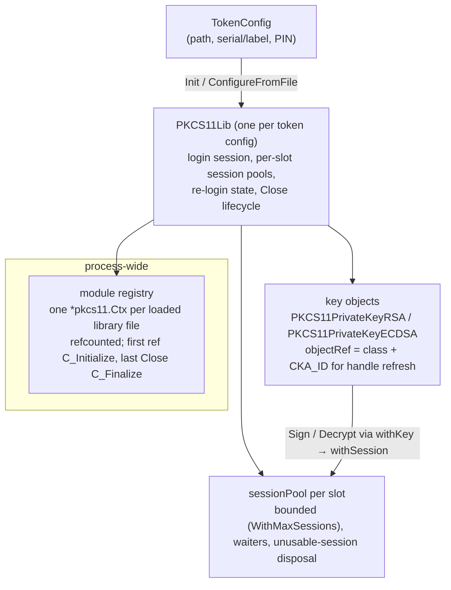

# crypto11: design

## Purpose and position

`crypto11` is the PKCS#11 backend of `cryptoprov`: it exposes keys that
live on an HSM, a smart card or SoftHSM as `crypto.Signer` (RSA, ECDSA) and
`crypto.Decrypter` (RSA) values, generates and finds key pairs on a token,
enumerates tokens and keys, and draws randomness from the device. It is a
fork of Thales `crypto11` over `github.com/miekg/pkcs11`, needs cgo, and
`dlopen`s the module named in the token config. It registers itself with
`cryptoprov.Register("SoftHSM", LoadProvider)`; the manufacturer name is
historical and any PKCS#11 v2.x module works.

## Core abstractions



| Abstraction             | File(s)                       | Role                                                                                                                                                        |
| ----------------------- | ----------------------------- | ----------------------------------------------------------------------------------------------------------------------------------------------------------- |
| `module`                | `module.go`, `module_dl_*.go` | Process-wide registry keyed by the dynamic-loader handle (unix) or path identity. Several `PKCS11Lib`s on one library share one `*pkcs11.Ctx`; the module is finalized only by the last `Close`, and never when it was initialized outside this package (XPKI-001/007). |
| `PKCS11Lib`             | `crypto11.go`, `config.go`    | The provider instance: selected slot, login session, pools, `Close()`. `Init` selects the token by every configured field (serial and label), logs in once and keeps that session open so pooled sessions inherit the login. |
| `sessionPool`           | `sessions.go`                 | Bounded pool per slot; `withSession` borrows, runs a callback, and recovers from stale sessions and logouts (`relogin`, XPKI-110) at most once each per call. Sessions that failed with device or handle errors are discarded, never reused. |
| Key objects             | `rsa.go`, `ecdsa.go`, `keys.go` | `PKCS11PrivateKeyRSA`/`PKCS11PrivateKeyECDSA` hold the object handle, slot and public key. `withKey` re-finds the object by `CKA_ID` when a handle was invalidated by a logout. `privateKeyGen` wraps a generated key with its id and label so `IdentifyKey` is cheap. |
| Attribute codec         | `common.go`                   | `CK_ULONG` encode/decode at the platform width (XPKI-011), key type and class name maps, ECDSA signature DER helpers, label and id generation from token randomness. |
| `cryptoprov` glue       | `provider.go`                 | `LoadProvider`, `EnumTokens`, `EnumKeys` (own read-only session, re-login check), `KeyInfo`.                                                              |

## Main flows

Opening a token (`Init`):

1. Resolve the module: look it up in the registry by loader handle or path;
   the first reference runs `C_Initialize`.
2. `selectToken`: list slots with tokens, match every nonempty configured
   field; no selector at all is an error before the module is loaded.
3. Open the login session on the slot and `C_Login` with `Config.Pin()`
   (literal or `file:`). On any failure after the load, release the module
   reference and close what was opened.

An operation on a key (`Sign`, `Decrypt`, `IdentifyKey`):

```mermaid
sequenceDiagram
    participant C as caller
    participant K as PKCS11PrivateKey*
    participant W as withKey / withSession
    participant T as token
    C->>K: Sign(digest, opts)
    K->>W: borrow session on key.Slot
    W->>T: C_SignInit(mechanism) + C_Sign(handle, digest)
    alt CKR_OBJECT_HANDLE_INVALID / CKR_KEY_HANDLE_INVALID
        W->>T: C_FindObjects by class + CKA_ID (exactly one match)
        W->>T: retry once with the new handle
    else CKR_USER_NOT_LOGGED_IN on the login slot, session is public
        W->>T: relogin (serialized, one C_Login for all waiters) then retry once
    else stale session (CKR_SESSION_HANDLE_INVALID / CLOSED)
        W->>W: purge idle sessions of the slot, open a new one, retry once
    end
    W-->>K: signature
    K-->>C: DER (r,s) for ECDSA; PKCS#1 v1.5 or PSS for RSA
```

Key generation (`GenerateRSAKey`, `GenerateECDSAKey`): one
`C_GenerateKeyPair` with public and private templates (`CKA_TOKEN`,
`CKA_PRIVATE`, `CKA_SENSITIVE`, `CKA_EXTRACTABLE=false`, usage flags from
the purpose, label and id generated from token randomness when empty). Once
the pair exists, a failure to read the public key or the id destroys the
pair and is returned wrapped in `noRetry`, so a retry never leaves an
orphan or duplicates a caller-supplied id.

## Design decisions

- **Share the module, not the sessions.** PKCS#11 forbids a second
  `C_Initialize` in a process; the registry makes concurrent `PKCS11Lib`s
  on one library safe and makes `Close` deterministic (finalize only when
  the last user is gone).
- **One login session per `PKCS11Lib`, pooled working sessions.** The
  login state belongs to the token and is inherited by every session on
  the slot; keeping one logged-in session alive avoids repeated
  `C_Login` and keeps SoftHSM, which logs out when the last session
  closes, logged in.
- **Lazy, bounded recovery.** Logouts, token reinsertion and stale
  handles are detected from the error codes of the failing call and
  repaired at most once per failure class per call, so a broken token
  cannot make a `Sign` loop. A PIN failure is sticky to avoid locking the
  token (XPKI-110).
- **Keys remember their identity, not their handle.** Handles die with a
  logout; `CKA_ID` does not. The exported `PKCS11Object.Handle` is kept
  for compatibility and may be stale.
- **Digest-in signing.** `Sign` receives a digest and `opts.HashFunc()`:
  RSA PKCS#1 v1.5 wraps the `DigestInfo` itself (`CKM_RSA_PKCS`), PSS and
  OAEP pass parameters (`CKM_RSA_PKCS_PSS`, `CKM_RSA_PKCS_OAEP`), ECDSA
  signs the raw digest (`CKM_ECDSA`) and the `(r, s)` pair is DER-encoded
  to match `crypto/ecdsa`.
- **Public key needs a public object.** A token stores the public half
  as a separate `CKO_PUBLIC_KEY` with the same id/label; export and
  `FindKeyPair` read it from there.
- **Panics only at init.** `mustMarshal` builds the curve OID table;
  everything else returns wrapped errors. `Sign(nil opts)` on RSA panics
  like the standard library.

## Extension points

- **A new key type** needs: a `CKK_*` entry in `KeyTypeNames` and
  `keyTypeAndClass`, a branch in `findKeyPairOnSession`, a key object type
  with `Sign` (and `Decrypt`) built on `withKey`, a generator on
  `PKCS11Lib` with templates and the `CKM_*_KEY_PAIR_GEN` mechanism, public
  key export from the public object's attributes, a case in
  `ConvertToPublic` and `IdentifyKey`, and `getPublicKeyPEM` support for
  `KeyInfo(includePublic)`.
- **Mechanism constants** come from `miekg/pkcs11`; constants the binding
  does not define (newer PKCS#11 versions) can be declared locally with the
  values from the specification header.
- **Test seams** are `sessionOps` (open/close/login/state/find) for
  fixture-free pool and re-login tests, and `exportKeyAdmitted` for the
  `Close` race in `ExportKey`.

## Testing

`TestMain` loads `/tmp/xpki/softhsm_unittest.json` when present (`make
hsmconfig`); SoftHSM tests call `requireP11` (`testenv.RequireFile`). Pool,
re-login, lifecycle and `Close` semantics are tested without a token
through `sessionOps`; module sharing, finalize and bare-name aliasing
re-execute the test binary as a child process. Keys generated by tests
persist in the token unless destroyed.

## Post-quantum readiness

PKCS#11 v3.2 defines ML-DSA objects and mechanisms (`CKK_ML_DSA`,
`CKA_PARAMETER_SET` with `CKP_ML_DSA_44/65/87`, `CKM_ML_DSA_KEY_PAIR_GEN`,
`CKM_ML_DSA` for pure signing with an optional context and hedge
parameter, `CKM_HASH_ML_DSA` for the pre-hash variant). Checked on
2026-11-08: `github.com/miekg/pkcs11` v1.1.2 defines none of these
constants, and SoftHSM 2.6.1 (the test fixture) does not implement them.
ML-DSA support in this package therefore needs a v3.2-capable module for
tests (a software token such as Kryoptic, or a vendor HSM) and locally
declared constants. The ML-DSA mechanism signs the **message**, not a
digest, so a `PKCS11PrivateKeyMLDSA.Sign` must take the full message with
nil or `*mldsa.Options`, and the external-μ form (`crypto.MLDSAMu`, 64
bytes) only where the module supports it.

| Location                                              | Today                                           | Needed                                                                                         |
| ----------------------------------------------------- | ----------------------------------------------- | ---------------------------------------------------------------------------------------------- |
| `common.go` `KeyTypeNames`, `keyTypeAndClass`         | RSA, DSA, DH, EC                                | `CKK_ML_DSA` → `ML-DSA`; constants declared locally until the binding has them                 |
| `keys.go` `findKeyPairOnSession`                      | `CKK_RSA`, `CKK_EC` branches                    | `CKK_ML_DSA` branch; public key from `CKA_VALUE` + `CKA_PARAMETER_SET` → `mldsa.NewPublicKey`  |
| `keys.go` `ConvertToPublic`, `IdentifyKey`            | RSA/ECDSA key object types                      | ML-DSA key object type                                                                         |
| `keys.go` `GenerateRSAKey`/`GenerateECDSAKey`         | Two generators                                  | `GenerateMLDSAKey(label, params)` with `CKM_ML_DSA_KEY_PAIR_GEN` and `CKA_PARAMETER_SET`       |
| new `mldsa.go`                                        | —                                               | `PKCS11PrivateKeyMLDSA`: `Sign` (message semantics), `withKey` handle refresh                   |
| `util.go` `getPublicKeyPEM`                           | RSA/ECDSA PKIX                                   | PKIX for `*mldsa.PublicKey` (Go 1.27 `x509.MarshalPKIXPublicKey` supports it)                  |
| `provider.go` `EnumKeys`, `KeyInfo`                   | Type from `KeyTypeNames`                        | Follows the map; add the parameter set to `KeyInfo.Meta`                                       |
| Test fixture, `scripts/config-softhsm.sh`, CI         | SoftHSM only                                    | A second, gated token config for a v3.2 module; skip when absent, fail with `XPKI_INTEGRATION=required` only where CI provisions it |
