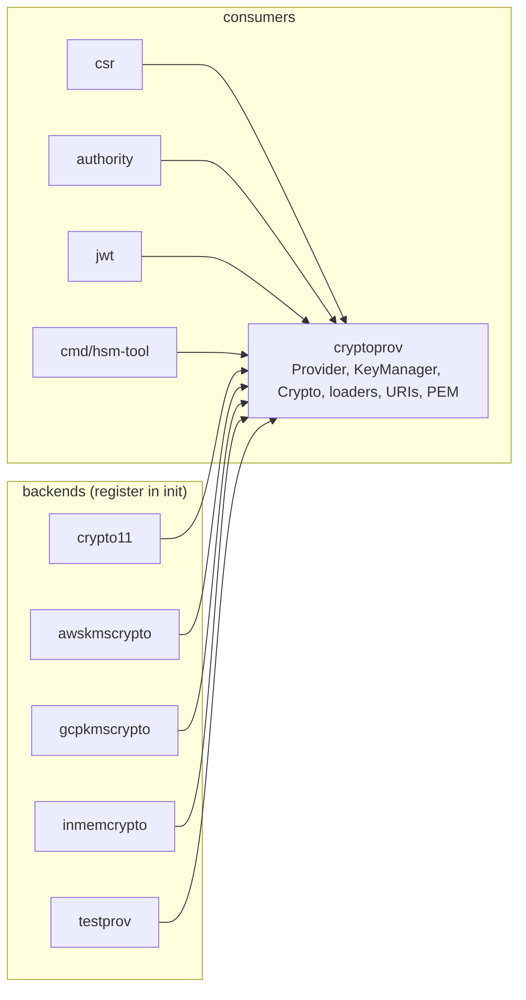

# cryptoprov: design

## Purpose and position

`cryptoprov` is the hub of the module's dependency graph. It defines the
provider contract that every key backend implements and that every consumer
(`csr`, `authority`, `jwt`, the CLIs) programs against, so that a caller can
move a CA or a JWT signer between an in-process key, a PKCS#11 token, AWS KMS
and Google Cloud KMS by changing a small configuration file. It owns no
cryptography of its own beyond parsing keys and AES-GCM helpers; the
backends live in sibling packages (`crypto11`, `cryptoprov/awskmscrypto`,
`cryptoprov/gcpkmscrypto`, `cryptoprov/inmemcrypto`, `cryptoprov/testprov`).

The dependency direction is one way and enforced by review: `cryptoprov`
never imports a backend. Backends import `cryptoprov` and register
themselves from `init()`; consumers blank-import the backends they want
available (see [`codemap.md`](../codemap.md#package-cryptoprov)).



## Core abstractions

| Abstraction          | File                    | Role                                                                                                                                                                                                                                                                         |
| -------------------- | ----------------------- | ---------------------------------------------------------------------------------------------------------------------------------------------------------------------------------------------------------------------------------------------------------------------------- |
| `Provider`           | `provider.go`           | `KeyGenerator` plus `Manufacturer()`/`Model()`. The identity pair is what a key URI names and what `Crypto` indexes by.                                                                                                                                                      |
| `KeyGenerator`       | `provider.go`           | The key surface: `GenerateKey(ctx, *GenerateKeyRequest)` for every algorithm (type, size, usage, tags), `GetKey`, `IdentifyKey`, `ExportKey`. Keys are opaque `crypto.PrivateKey` values that also implement `crypto.Signer` (and `crypto.Decrypter` where the backend can). |
| `KeyManager`         | `provider.go`           | Optional management surface: `ListKeys` by page and filter, `KeyInfo` by field mask, `DestroyKey`. Not embedded in `Provider`; callers type-assert. Every provider of the module implements it. The contract and its listing rules are in [keymanager.md](keymanager.md).    |
| `TokenManager`       | `provider.go`           | Optional: the tokens of a provider with several stores (`ListTokens`, `Token`). Only `crypto11` implements it.                                                                                                                                                               |
| Key management types | `keys.go`, `errors.go`  | `KeyInfo`, `KeyUsage`, `KeyState`, `KeyFields`, `KeyFilter`, the requests, `AllKeys`, and the helpers for provider authors (`PageKeys`, page tokens, `MarkError`).                                                                                                           |
| `Crypto`             | `provider.go`           | Registry of loaded providers: one default plus lookup by manufacturer and model. Resolves `pkcs11:` key URIs to a provider and a key.                                                                                                                                        |
| Loader registry      | `loader.go`             | Process-global map manufacturer → `ProviderLoader`, filled by backend `init()`; `LoadProvider`/`Load` turn config files into providers.                                                                                                                                      |
| `TokenConfig`        | `config.go`             | The small JSON/YAML token file: manufacturer, model, module path, token serial/label, PIN (literal or `file:`), free-form `Attributes` for KMS options.                                                                                                                      |
| Key URI              | `uri.go`                | RFC 7512 `pkcs11:` URI parser. A private key is addressed by manufacturer, model, serial, token, `id` and `type=private`; the URI is what `ExportKey` returns for non-exportable keys and what issuer and JWT configs store in place of a PEM key.                           |
| PEM / TLS helpers    | `utils.go`, `signer.go` | `LoadPrivateKey` accepts a PEM key or a key URI; `ParsePrivateKeyDER` accepts PKCS#8, PKCS#1 and SEC1; `TLSKeyPair` pairs a chain with either kind of key.                                                                                                                   |
| AES-GCM helpers      | `gcm.go`                | `GcmEncrypt`/`GcmDecrypt` with a prefixed nonce, used by callers for small secrets.                                                                                                                                                                                          |

## Main flows

Loading providers from configuration:

```mermaid
sequenceDiagram
    participant App
    participant L as cryptoprov.Load
    participant R as loader registry
    participant B as backend loader
    App->>L: Load(defaultCfg, [otherCfgs])
    L->>L: LoadTokenConfig(file) (JSON by .json suffix, else YAML; "" or "inmem" = in-memory)
    L->>R: loaders[cfg.Manufacturer()]
    R-->>L: ProviderLoader
    L->>B: loader(cfg)
    B-->>L: Provider (opens module / KMS client)
    L->>L: New(default) then Add(each) — duplicate manufacturer+model is ErrDuplicateProvider
    Note over L: on any error, providers already loaded that implement Close() are closed
    L-->>App: *Crypto
```

Resolving a key reference (`Crypto.LoadPrivateKey`, used by
`NewSignerFromFromFile`, `TLSKeyPair`, `authority.NewIssuerWithBundles` and
`jwt.LoadProvider`):

1. Input starting with `pkcs11` is parsed as a private-key URI
   (`ParsePrivateKeyURI`: `type=private`, `serial` and `id` required,
   `pin-value` redacted in errors).
2. `ByManufacturer(manufacturer, model)` finds the provider (the default
   first, then the registered map).
3. `provider.GetKey(id)` returns the opaque key; the caller asserts
   `crypto.Signer`.
4. Anything else is parsed as PEM (`ParsePrivateKeyPEM`), with the legacy
   RFC 1423 encrypted-PEM path kept for compatibility.

## Design decisions

- **Opaque keys, standard interfaces.** Backends return `crypto.PrivateKey`
  values that implement `crypto.Signer`. Consumers never see provider
  types, so a CA signer, a JWT signer and a TLS key are interchangeable
  across backends. The price is that algorithm-specific behavior has to
  be discovered through `Public()` type switches (RSA, ECDSA) in each
  consumer; see the post-quantum section below.
- **Digest-in, signature-out.** The `crypto.Signer` contract as used by
  this module is hash-then-sign: callers hash the message, pass the digest
  and `opts.HashFunc()` names the hash (the KMS signers reject nil
  options, XPKI-025). Only `x509.CreateCertificate`,
  `x509.CreateCertificateRequest` and `x509.CreateRevocationList` hash for
  the caller.
- **Provider identity = manufacturer + model.** `Crypto` indexes providers
  by that pair, a key URI carries it, and `Load` rejects two configs with
  the same pair (`ErrDuplicateProvider`, XPKI-016). This lets several
  tokens or KMS accounts coexist in one process.
- **Process-global loader registry, instance-level provider registry.**
  Loaders are registered once per process from `init()` (`Register` fails
  on a duplicate name); providers are instances held by a `Crypto`. Tests
  register throwaway loaders under unique names and unregister them.
- **Lock-free lookups.** `Crypto.Add` copies the provider map and
  publishes it through an `atomic.Pointer`; `ByManufacturer` reads without
  a lock, so a hot signing path never contends with provider loading.
- **`context.Context` on every interface method (v2).** The KMS backends
  pass it to their SDK requests, and `crypto11`, whose PKCS#11 calls cannot
  be cancelled, bounds the wait for a session with it. The functions that
  load or generate a key take it too. The exception is signing:
  `crypto.Signer` has no context, so `Signer.Sign` of the KMS backends still
  uses `context.Background()` (roadmap item 1). The loaders (`Load`,
  `LoadProvider`) have none either.
- **One generator, one listing.** v1 had a generator method per algorithm and
  an `EnumKeys` that returned every key with every field; v2 has
  `GenerateKey` with a request and `ListKeys` with pages, a filter and a
  field mask, so a new algorithm, usage or filter condition does not change
  an interface. The reasons and the per-provider cost are in
  [keymanager.md](keymanager.md).
- **Errors.** `cockroachdb/errors` everywhere; sentinels (`ErrInvalidURI`,
  `ErrInvalidPrivateKeyURI`, `ErrNilProvider`, `ErrDuplicateProvider`,
  `ErrKeyNotFound`, `ErrNotSupported`, `ErrInvalidPageToken`) are
  always wrapped so `errors.Is` works and stacks are preserved. Where a
  backend error must stay reachable with `errors.As` (the KMS "not found"),
  a provider marks it with `MarkError` instead of replacing it.

## Extension points

- **A new backend** implements `Provider` (and `KeyManager` when it can
  enumerate), picks a manufacturer name, calls `cryptoprov.Register` from
  `init()`, and documents its `Attributes` keys. It must return keys that
  implement `crypto.Signer`, implement `IdentifyKey` for the keys it
  returns, and have `ExportKey` return either PEM bytes (exportable keys)
  or a `pkcs11:` URI (non-exportable keys).
- **A new key algorithm** has no entry point today: `KeyGenerator` names
  RSA and ECDSA explicitly. Adding one means either widening the interface
  (a breaking change for external implementers) or adding an optional
  interface that consumers type-assert. See [pqc.md](pqc.md), decision D1.

## Testing

Unit tests are fixture-free with `inmemcrypto` and `testprov`; four tests
need the SoftHSM token and are gated with `internal/testenv.RequireFile`
(XPKI-100). `crypto_concurrency_test.go` races `Add` against lookups.

## Post-quantum readiness

Implemented in v1.1 (see [pqc.md](pqc.md) for the cross-cutting design):

- ML-DSA is a key `Type` of `GenerateKeyRequest` (`certutil.KeyTypeMLDSA`
  with `Size` 44, 65 or 87); v1.1 had a `GenerateMLDSAKey` method, which v2
  folded into `GenerateKey`. Every provider in this module implements it.
- `mldsa.go` holds the shared pieces of the contract: `MLDSAParameters`
  (44/65/87 → `mldsa.Parameters`), `MLDSASignerOptions` (the message with
  nil, zero-hash or `*mldsa.Options`; μ with `crypto.MLDSAMu`; every
  digest hash rejected) and `MLDSAMu` (FIPS 204 Algorithm 7, used by the
  KMS signers so the message never leaves the process).
- `KeyInfo.Type` is `ML-DSA` and `Meta[MetaParameterSet]` the parameter set
  name for ML-DSA keys; the KMS providers now also fill `Type` for RSA and
  ECDSA keys.
- `ParsePrivateKeyDER`/`ParsePrivateKeyPEM` return `*mldsa.PrivateKey` for
  a PKCS#8 seed-form key; the seed-and-expanded form OpenSSL writes by
  default is rejected by the standard library.

Remaining: the `Provider` interfaces still take no `context.Context`
(ROADMAP item 1).
