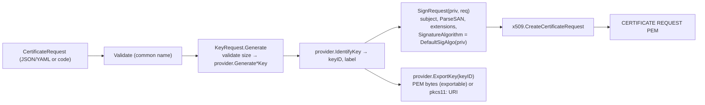

# csr: design

## Purpose and position

`csr` holds the request vocabulary shared by the CA, the JWT package and
the CLIs: what a certificate request looks like as JSON/YAML
(`CertificateRequest`, `KeyRequest`, `X509Subject`, `X509Extension`), what
a registration authority sends to an issuer (`SignRequest`), and the code
that turns a request into a key plus a PEM CSR through a
`cryptoprov.Provider`, or a PEM CSR into an `x509.Certificate` template.
It also owns the subject and SAN rules (`PopulateName`, `ParseSAN`,
`ApplySAN`), the CRL distribution point encoder and the JSON/YAML `OID`
and `Duration` types. It depends on `cryptoprov` and `oid` only; `authority`,
`jwt` and `cmd/hsm-tool` depend on it.

## Core abstractions

| Abstraction                 | File         | Role                                                                                                                                       |
| --------------------------- | ------------ | ------------------------------------------------------------------------------------------------------------------------------------------ |
| `CertificateRequest`        | `csr.go`     | What to put in a CSR: common name, `Names` (C/ST/L/O/OU/email, lowercase keys), serial, `SAN` strings, `KeyRequest`, raw `Extensions`.      |
| `KeyRequest`                | `keyreq.go`  | `label`, `algo` (`RSA`/`ECDSA`, case-insensitive), `size` (bits or curve size), `purpose` (signing/encryption). Carries an unexported provider; `Generate()` dispatches to `GenerateRSAKey`/`GenerateECDSAKey` after validating the size. |
| `Provider`                  | `csrprov.go` | Thin wrapper over one `cryptoprov.Provider`: `GenerateKeyAndRequest`, `CreateRequestAndExportKey`, `SignRequest`, `NewKeyRequest`.          |
| `SignRequest`               | `csr.go`     | RA → issuer: PEM CSR, profile name, optional subject override, SAN list (nil = keep CSR names), raw extensions, optional validity.          |
| `Parse` / `ParsePEM`        | `csr.go`     | Verify the CSR signature and build an `x509.Certificate` template with subject, SANs, public key and every extension except BasicConstraints in `ExtraExtensions`, leaving policy to the issuer. |
| `SAN`, `ParseSAN`, `ApplySAN` | `san.go`   | Classify strings into DNS/IP/email/URI, validate (IDNA, label rules, wildcards), dedupe; strict since XPKI-059.                              |
| `SigAlgo`, `DefaultSigAlgo`, `SignatureAlgorithmer` | `keyreq.go`, `csrprov.go` | Choose the X.509 signature algorithm from the key: RSA 2048/3072 → SHA-256, ≥4096 → SHA-512, ECDSA by curve; a signer may dictate it (`SignatureAlgorithmer`, used by GCP KMS). |
| `OID`, `Duration`           | `types.go`   | JSON/YAML-friendly wrappers used by profiles and requests.                                                                                 |

## Main flows

On the receiving side `ParsePEM` → `Parse` verifies the self-signature
(`CheckSignature`), so a CSR whose key does not match its signature is
rejected before any policy runs, and returns a template whose extensions
the issuer filters (`authority`, XPKI-049).

## Design decisions

- **Requests are data.** `KeyRequest` is a plain struct with string and
  int fields so it round-trips through YAML profiles
  (`authority/testdata/csrprofiles/*.yaml`) and CLI flags
  (`hsm-tool hsm generate --algo --size`). The provider is injected by
  `Provider.GenerateKeyAndRequest` for requests decoded from files.
- **`size` is overloaded.** It is the modulus size for RSA and the curve
  size (256/384/521) for ECDSA. Validation happens in `Generate`, before
  the provider is called, so an unsupported size never reaches a token or
  a KMS API.
- **Signature algorithm follows the key, never the request.** `SigAlgo`
  and `DefaultSigAlgo` never return SHA-1 and give RSA-3072 SHA-256
  (XPKI-114) so that GCP KMS keys and local keys sign the same way. A
  signer that only supports one algorithm advertises it through
  `SignatureAlgorithmer`.
- **Strict SANs.** Invalid names fail the request instead of being
  dropped; `SetSAN` keeps the old lenient behavior and is deprecated.
- **`Parse` is policy-free.** It keeps CSR extensions in
  `ExtraExtensions` and leaves allow-listing to the issuer, so the two
  packages have one place each for "what the CSR says" and "what the CA
  accepts".

## Extension points

- **A new key algorithm** touches `KeyRequest.Generate` (a new `case` and
  validator), `SigAlgo` (algo string → `x509.SignatureAlgorithm`) and
  `DefaultSigAlgo` (public key type → algorithm). Everything downstream
  (`SignRequest`, `Parse`) is key-type agnostic as long as `crypto/x509`
  supports the key.
- **Request vocabulary** grows by adding fields with JSON and YAML tags
  (lowercase YAML keys; uppercase keys are silently ignored by the
  decoder).

## Testing

`csrprov_test.go` is the only SoftHSM-dependent test and is gated with
`testenv.RequireFile`; everything else uses `inmemcrypto`. `san_test.go`
and `sigalgo_test.go` are table tests for the SAN rules and the hash
defaults.

## Post-quantum readiness

Checked on 2026-11-08 with Go 1.27.3: `x509.CreateCertificateRequest`,
`ParseCertificateRequest` and `CheckSignature` work with `*mldsa.PrivateKey`
and `*mldsa.PublicKey` (`PublicKeyAlgorithm` `ML-DSA`, signature algorithms
`x509.MLDSA44/65/87`), so `SignRequest` and `Parse` need no change once a
provider returns an ML-DSA signer. The package changes are in the key
request and algorithm selection:

| Location                                   | Today                                                              | Needed                                                                                                                                  |
| ------------------------------------------ | ------------------------------------------------------------------ | --------------------------------------------------------------------------------------------------------------------------------------- |
| `keyreq.go` constants                      | `CurveP256/384/521`                                                | `AlgoMLDSA = "ML-DSA"`, parameter sets `MLDSA44/65/87` ([PR 568](https://github.com/effective-security/xpki/pull/568) adds them)        |
| `keyreq.go` `KeyRequest.Generate`          | `RSA`, `ECDSA` cases                                               | `ML-DSA` case: validate the parameter set, then call the provider's ML-DSA generator; until providers implement it, return "not implemented" (the review comment on PR 568: do not suggest a recovery path that does not exist) |
| `keyreq.go` `SigAlgo`                      | RSA/ECDSA → hash-based algorithms                                  | `("ML-DSA", 44/65/87)` → `x509.MLDSA44/65/87`                                                                                           |
| `csrprov.go` `DefaultSigAlgo`              | Switch on `*rsa.PublicKey`, `*ecdsa.PublicKey`                     | `*mldsa.PublicKey` → by `Parameters()`                                                                                                   |
| `keyreq.go` `IsPostQuantumAlgo`            | — (added by PR 568)                                                | Keep for algo names; key-based detection belongs in `certutil` (leaf package) so `authority` and `jwt` can share it                      |
| `csrprov.go` `SignRequest`, `csr.go` `Parse` | Key-type agnostic                                                | No change (verified)                                                                                                                   |
| `doc.go`                                   | "RSA, ECDSA"                                                       | Add ML-DSA when generation works end to end                                                                                             |

Decisions to take before implementing (recorded in [pqc.md](pqc.md)):
whether `size` carries the parameter set (`44`/`65`/`87`, as PR 568
proposes) or a new field does; which spellings of the algorithm name are
accepted (`ML-DSA`; `DILITHIUM` as a legacy alias or not); and whether
hybrid/composite signatures are in scope (not in the first milestone).
