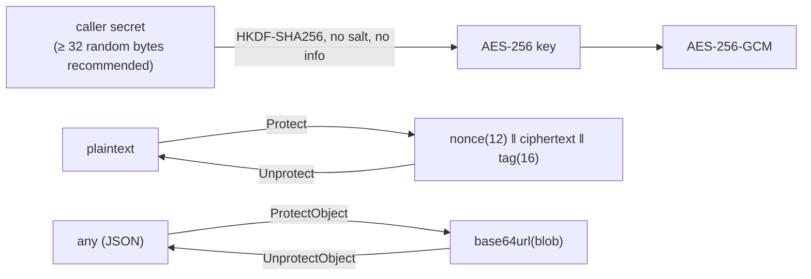

# dataprotection: design

## Purpose and position

`dataprotection` protects small payloads at rest or in transit inside a
service: session state, opaque access tokens (`jwt/accesstoken`), cached
secrets. It offers one interface, `Provider`, with a symmetric
implementation (`NewSymmetric`) and two helpers that protect and unprotect
JSON objects as base64url strings. It depends only on the standard library
and `golang.org/x/crypto/hkdf`; `jwt/accesstoken` is its in-repo consumer.

## Core abstractions

| Abstraction                         | File           | Role                                                                                                                                         |
| ----------------------------------- | -------------- | -------------------------------------------------------------------------------------------------------------------------------------------- |
| `Provider`                          | `dp.go`        | `Protect(ctx, data)`, `Unprotect(ctx, blob)`, `IsReady()`, `PublicKey()`. The context and `PublicKey` exist so that an asymmetric or remote (KMS) provider can implement the same interface. |
| `NewSymmetric(secret)`              | `symmetric.go` | HKDF-SHA256 → AES-256-GCM; random 96-bit nonce per call; constants `SymmetricNonceSize`, `SymmetricTagSize`, `SymmetricOverhead`, `SymmetricMinSecretSize`, `SymmetricMaxMessagesPerKey`. |
| `ProtectObject` / `UnprotectObject` | `dp.go`        | JSON marshal → `Protect` → base64url, and back.                                                                                               |

## Design decisions

- **Derive, do not use the secret directly.** HKDF turns any high-entropy
  secret into a fixed-size key and keeps the provider stable if the
  cipher changes. It does not stretch a passphrase, and the package
  documentation says so (XPKI-083): the secret is key material.
- **Random nonces, documented budget.** A random 96-bit nonce avoids
  shared counters across instances; the NIST SP 800-38D bound of 2^32
  messages per key is exported as a constant and left to the caller to
  enforce, because the package has no persistent state.
- **No associated data, no key id, no version byte.** The blob is the
  minimum for AES-GCM. Rotation is the caller's (record which secret
  protected a blob; keep old providers to read; re-protect on read). A
  versioned format with a key id and a multi-key provider is roadmap
  work; `Unprotect` must keep accepting the legacy layout during a
  migration.
- **Interface wide enough for asymmetric providers.** `Protect` and
  `Unprotect` take a `context.Context` (the only interfaces in the module
  that do) and the interface has `PublicKey()`, so a provider that
  encrypts to a public key or calls a KMS fits without a change.

## Extension points

- **Another provider** implements the four methods. An asymmetric one
  returns its public key from `PublicKey()`, a remote one honours the
  context.
- **Versioned blobs** should be added as a new constructor that writes
  `version || key-id || nonce || ciphertext || tag` and whose `Unprotect`
  recognizes both layouts (see [ROADMAP.md](../../ROADMAP.md)).

## Testing

Pure unit tests: round trips, tampering, wrong secret, short blobs;
`symmetric_limits_test.go` checks the exported constants against the
AEAD; `example_test.go` compiles the documented usage.

## Post-quantum readiness

The package is symmetric: AES-256-GCM with a 256-bit key is considered
quantum-resistant (Grover's algorithm halves the effective key length to
128 bits, which stays adequate), and HKDF-SHA256 is a hash construction
without a known quantum weakness. ML-DSA, a signature scheme, has no role
here. No change is needed for the ML-DSA milestone.

| Location                | Today                           | Needed                                                                                                                                                      |
| ----------------------- | ------------------------------- | ----------------------------------------------------------------------------------------------------------------------------------------------------------- |
| `symmetric.go`          | AES-256-GCM, HKDF-SHA256        | None                                                                                                                                                       |
| `dp.go` `Provider`      | `PublicKey()` for asymmetric providers | None now. A future asymmetric envelope provider (a key-encapsulation step with ML-KEM from `crypto/mlkem`, Go 1.24+, wrapping the symmetric key) fits the interface; it is out of scope for the signature milestone and would be a separate roadmap item |
